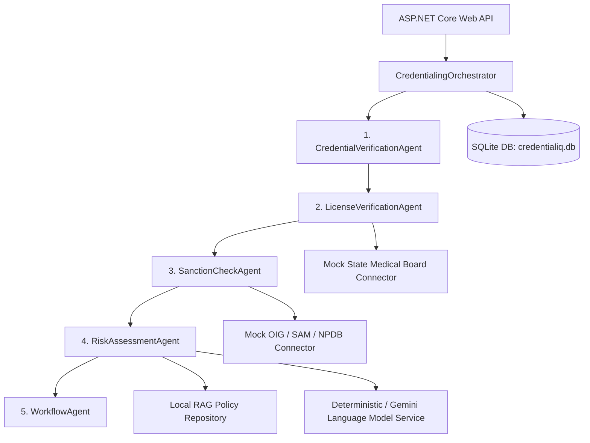

# CredentialIQ AI - Autonomous Healthcare Credentialing POC

[]()
[]()
[]()

> [!IMPORTANT]
> **POC Legal Disclaimer**: CredentialIQ AI is a proof-of-concept system utilizing simulated connectors and synthetic policy rules. POC outputs do not constitute official credentialing determinations and require review and authorization by a qualified human credentialing committee.

---

## Overview

**CredentialIQ AI** is an agentic healthcare provider credentialing proof of concept built with .NET 8, ASP.NET Core, and Microsoft Semantic Kernel architectural patterns. The platform automates provider intake, primary-source verification, sanction screening, policy retrieval (via a local vector-like RAG repository), AI risk assessment, and workflow recommendations—producing a complete, UTC-timestamped evidence audit trail.

---

## Key Features

- **5-Agent Pipeline**: Sequential execution flow (`CredentialVerificationAgent` -> `LicenseVerificationAgent` -> `SanctionCheckAgent` -> `RiskAssessmentAgent` -> `WorkflowAgent`).
- **Deterministic & Gemini LLM Support**: Dual-adapter risk assessment engine with automatic PII redaction and safe deterministic fallback on API timeout or malformed JSON.
- **Local Policy RAG Repository**: Seeded synthetic NCQA, state law, payer rule, and SOP policy chunks in `knowledge/`.
- **Primary Source Mock Connectors**: Deterministic state board, OIG, SAM.gov, and NPDB connectors with explicit `IsSimulated = true` evidence tagging.
- **Complete Audit Trail & Manual Overrides**: Immutable audit events with correlation ID tracking and human reviewer override support.
- **Local Persistence**: Zero Azure dependencies using Entity Framework Core with SQLite (`credentialiq.db`).

---

## System Architecture



---

## Prerequisites

- **.NET 8 SDK** (8.0.100 or later)
- Cross-platform terminal (Bash or PowerShell)

---

## Quick Start Commands

### 1. Build and Test Solution
```bash
# Using bash
./scripts/setup.sh

# Using PowerShell
.\scripts\setup.ps1
```

### 2. Run API Locally
```bash
# Using bash
./scripts/run.sh

# Using PowerShell
.\scripts\run.ps1
```
The Web API will launch on **`http://localhost:5050`**.  
Interactive Swagger documentation is available at **`http://localhost:5050/swagger`**.

### 3. Run Automated API Smoke Tests
In a separate terminal while the API is running:
```bash
# Using bash
./scripts/smoke-test.sh

# Using PowerShell
.\scripts\smoke-test.ps1
```

---

## Environment Variables

Configure in `.env` or set in your environment:

| Variable | Default | Description |
| :--- | :--- | :--- |
| `ConnectionStrings__DefaultConnection` | `Data Source=credentialiq.db` | SQLite database connection string |
| `Llm__Provider` | `Deterministic` | Risk assessment model provider (`Deterministic` or `Gemini`) |
| `GEMINI_API_KEY` | *(None)* | Gemini API Key (Required if `Llm__Provider=Gemini`) |
| `Gemini__Model` | `gemini-2.5-flash` | Gemini model name |

---

## Project Structure

```
CredentialIQ.sln
Directory.Build.props
src/
  CredentialIQ.Core/            # Domain models, DTOs, Enums, Interfaces
  CredentialIQ.Infrastructure/  # EF Core DbContext, SQLite, Connectors, RAG, LLM adapters
  CredentialIQ.Agents/          # 5 Credentialing Agents & Orchestrator pipeline
  CredentialIQ.Api/             # Controllers, Middleware, Swagger, Program.cs
tests/
  CredentialIQ.Tests/           # xUnit Unit & Integration WebApplicationFactory tests
knowledge/                      # Seeded synthetic policy JSON documents
samples/                        # Sample clean, exception, and hold JSON payloads
scripts/                        # Cross-platform setup, run, and smoke-test scripts
docs/                           # Architecture, API, Security, and Assumptions docs
```

---

## Security & Compliance Summary

- **Synthetic Data**: 100% fictional test provider identities.
- **PII Minimization**: Automatic date-of-birth and sensitive field redaction before LLM prompts.
- **Strict Safety Constraint**: Suspended licenses and sanction matches **never auto-approve**.
- **Auditability**: UTC timestamps and correlation IDs attached to every evidence record.
