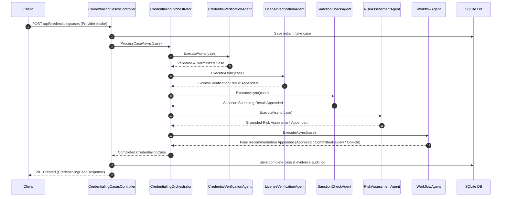

# CredentialIQ AI - Architecture Documentation

## System Component Architecture

```mermaid
graph TD
    Client[HTTP Client / Swagger UI / CLI] -->|REST API Requests| API[CredentialIQ.Api Layer]
    API -->|DI & Services| Orchestrator[CredentialingOrchestrator]
    
    subgraph Agent Pipeline (Sequential Flow)
        Agent1[1. CredentialVerificationAgent] --> Agent2[2. LicenseVerificationAgent]
        Agent2 --> Agent3[3. SanctionCheckAgent]
        Agent3 --> Agent4[4. RiskAssessmentAgent]
        Agent4 --> Agent5[5. WorkflowAgent]
    end

    Orchestrator -->|Passes CredentialingCase| Agent1
    
    Agent2 -->|Primary Source Mock| LicConnector[IVerificationConnector / MockStateBoard]
    Agent3 -->|Screening Mock| SancConnector[ISanctionConnector / MockSanction]
    Agent4 -->|Local RAG Search| RAGRepo[IRagRepository / LocalRagRepository]
    Agent4 -->|LLM Risk Analysis| LLM[ILanguageModelService / Deterministic or Gemini]
    
    RAGRepo -->|Seeded Synthetic Rules| PolicyStore[(knowledge/ directory JSON)]
    Orchestrator -->|EF Core Persistence| DB[(SQLite: credentialiq.db)]
```

---

## Agent Pipeline Sequence Diagram



---

## Local Development vs. Production Architecture

| Component | Local Proof-of-Concept Profile | Future Production Target Profile |
| :--- | :--- | :--- |
| **Database** | Entity Framework Core + SQLite | Azure SQL / PostgreSQL with Geo-Replication |
| **RAG Policy Engine** | `LocalRagRepository` (Keyword + TF Scoring) | Azure AI Search (Vector Hybrid Search + Azure OpenAI Embeddings) |
| **LLM Provider** | `DeterministicLanguageModelService` (or Gemini API) | Azure OpenAI / Gemini Enterprise Enterprise Tenant |
| **Primary Source Verification** | `MockStateBoardConnector` | Direct State Medical Board API Connectors / CAQH ProView API |
| **Sanction Screening** | `MockSanctionConnector` | Real-time OIG LEIE, SAM.gov, and NPDB Query Gateway |
